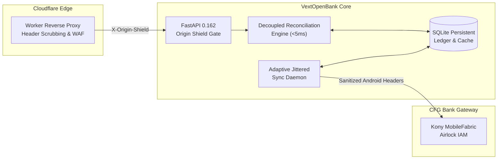

# VextOpenBank — Autonomous Open Banking Gateway & API Suite

<p align="center">
  
  
  
  
  
  
  
</p>

---

## 🏛️ Executive Summary

**VextOpenBank** is a high-performance, autonomous Open Banking API gateway and reconciliation bridge engineered for CFG Bank Morocco (Kony MobileFabric & Airlock IAM). It bridges programmatic operations for corporate accounts (VEXT AI) and provides a decoupled, zero-latency payment bridge for external platforms such as **EnvoiSMS.ma**.

Designed with bank-grade defense-in-depth, VextOpenBank shields downstream partners from bank latency and protects the bank infrastructure from connection spikes, throttling penalties, and behavioral fraud triggers.

---

## 📑 Comprehensive Documentation Index

| Guide | Description | Target Audience |
| :--- | :--- | :--- |
| 🗺️ [**System Map**](file:///Users/naouri/Downloads/VextOpenBank/docs/SYSTEM_MAP.md) | Exhaustive directory tree, module responsibilities, and LLM navigation roadmap. | LLMs, Auditors, Developers |
| 📐 [**Architecture Design**](file:///Users/naouri/Downloads/VextOpenBank/docs/ARCHITECTURE.md) | In-depth sequence diagrams, database schemas, and background worker loops. | System Architects, DevOps |
| 📲 [**EnvoiSMS Bridge Guide**](file:///Users/naouri/Downloads/VextOpenBank/docs/ENVOISMS_INTEGRATION.md) | Integration specs, HMAC-SHA256 verification samples (Python, Node, PHP), and SLAs. | Integration Partners |
| 🛡️ [**Security Architecture**](file:///Users/naouri/Downloads/VextOpenBank/docs/SECURITY.md) | Zero-Trust edge lockdown, header hygiene, and behavioral AI evasion. | Security Engineers |
| 📖 [**API Reference**](file:///Users/naouri/Downloads/VextOpenBank/docs/API_REFERENCE.md) | Complete OpenAPI endpoint catalog across all 12 modules with schemas. | Full-Stack Engineers |
| ☁️ [**Deployment Guide**](file:///Users/naouri/Downloads/VextOpenBank/cloudflare/DEPLOYMENT_GUIDE.md) | Cloudflare Worker Edge Shield and Render container deployment manual. | Infrastructure Engineers |

---

## ⚡ Core Capabilities



### 1. Zero-Latency Decoupled EnvoiSMS Bridge
* **Instant Sub-5ms Verification**: Top-up status inquiries check the local SQLite ledger (`cfg_incoming_transfers`) without blocking on network calls to the bank.
* **Double-Spend Protection**: Atomic SQLite uniqueness constraints prevent replay attacks and duplicate reconciliations.
* **Cryptographic Signatures**: Confirmed payments return an HMAC-SHA256 signature calculated with a shared secret.
* **Anti-Throttling Cooldown**: Bank synchronization enforces a minimum 25-second cooldown with randomized jitter ($\pm 15\%$), completely insulating CFG from client polling traffic.

### 2. Zero-Trust Cloudflare Edge Shield
* **Origin Lockdown**: The Render backend is protected by the `enforce_internal_security` middleware, rejecting any request lacking the cryptographic `X-Origin-Shield` header.
* **Header Scrubbing**: Strips server fingerprints (`Server`, `x-powered-by`, `rndr-id`, `x-render-origin-server`) and injects HSTS, framing protection, and anti-sniffing headers.
* **Route-Aware Authorization**: Public access to `/api/v1/envoisms/instructions` for seamless customer checkout, while locking sensitive endpoints behind `X-Vext-Key`.

### 3. Native Android Protocol Emulation & AI Evasion
* **Header Hygiene**: Strips downstream client IPs (`X-Forwarded-For`, `CF-Connecting-IP`, `Origin`) before dispatching requests to the bank.
* **Strict Android Profile**: Injects authentic Kony Android SDK headers and native device fingerprints.
* **Token Lifecycle Management**: Decodes JWT `exp` timestamps to reuse valid claims tokens, eliminating authentication churn.
* **Human-Like Jitter**: Sync loops and network calls introduce natural micro-variance ($50\text{ms} - 180\text{ms}$) to evade AI scraper detection.
* **Hardware Profile Persistence**: Guarantees identical `DEVICE_ID`, `CLIENT_ID`, and `PROFILE_ID` across service recycles.

### 4. Enterprise Open Banking Suite (12 Modules)
* **Accounts & Balances**: Ledgers, formatted Moroccan RIBs, and national Modulo-97 checksum validation.
* **Transfers & Impayés**: Domestic virements, registered payees, and bounced check reconciliation.
* **Cards Management**: Real-time spending limits, 3DS flags, and remote freeze/unfreeze.
* **Features & Utilities**: Office des Changes travel endowments, multi-utility bill payments, interbank mobile wallet (EMVCo QR), and remote check deposit with CMC7 OCR.
* **Personal Finance Management**: Expense categorization and 30-day liquidity analytics.
* **Communications & CRM**: Secure bank messaging inbox, Microsoft Dynamics CRM ticketing, and Kony KPNS push notifications.
* **Open Banking Automations**: Berlin Group NextGenPSD2 AIS/PIS schema compliance and CSV bookkeeping.

---

## 🚀 Quickstart & Local Development

### Prerequisites
* Python 3.12+
* macOS, Linux, or Docker
* Git

### Installation
```bash
# Clone the repository
git clone https://github.com/abdnaouri/VextOpenBank.git
cd VextOpenBank

# Create and activate virtual environment
python3 -m venv .venv
source .venv/bin/activate

# Install dependencies
pip install -r requirements.txt
```

### Environment Configuration
```bash
cp .env.example .env
# Edit .env with your environment settings
```

### Run the Application
```bash
# Start the local development server
PYTHONPATH=. python vext_open_bank/run_api.py
```
Access the interactive documentation:
* Swagger UI: `http://localhost:8000/docs`
* Built-In Diagnostic Dashboard: `http://localhost:8000/app`

---

## 🧪 Testing Suite

VextOpenBank includes an automated test suite covering unit logic, cryptographic signatures, anti-throttling cooldowns, and full integration workflows:

```bash
PYTHONPATH=. pytest -v
```

```
vext_open_bank/tests/test_envoisms.py .....                              [ 19%]
vext_open_bank/tests/test_features.py ......                             [ 42%]
vext_open_bank/tests/test_full_suite.py ...............                  [100%]

======================== 26 passed, 1 warning in 1.09s =========================
```

---

## 🌐 Production Deployments

| Component | Platform | Live URL |
| :--- | :--- | :--- |
| **Origin Backend** | Render.com (Frankfurt) | `https://vext-open-bank.onrender.com` |
| **Edge Shield** | Cloudflare Workers | `https://vext-open-bank-edge.a-naouri-10d.workers.dev` |

### Deploying the Cloudflare Worker
```bash
cd cloudflare
wrangler deploy
```

---

## 🔬 Reverse Engineering & Research Harness

The repository retains the research harness used to extract and reconcile the native Android APK (`com.cfgbank.mobileapp`) contracts:

```bash
# Execute the 6-stage contract extraction pipeline
./pipeline.sh all

# Or run individual stages:
./pipeline.sh setup       # Verify toolchain (apktool, jadx, frida)
./pipeline.sh profile     # Package triage and packer fingerprinting
./pipeline.sh decompile   # Static decompilation
./pipeline.sh extract     # Interface contract discovery
./pipeline.sh instrument  # Frida dynamic attachment scripts
./pipeline.sh reconcile   # Reconcile static contracts with dynamic runtime logs
```

---

## 📄 License & Confidentiality

Proprietary and confidential. Developed by the VEXT AI engineering team for programmatic banking operations and partner integrations.
