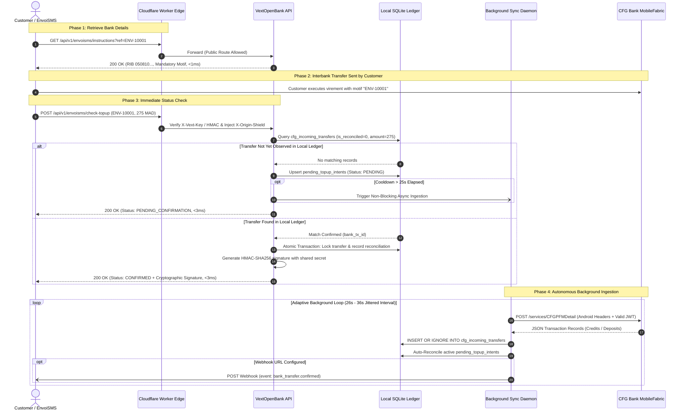
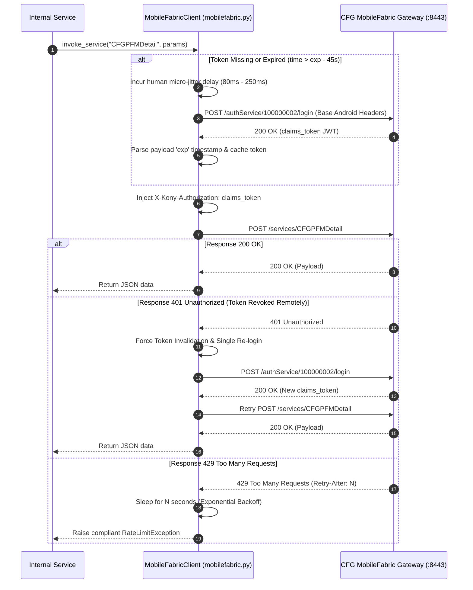

# VextOpenBank — Core Architectural Design & System Internals

---

## 1. Architectural Philosophy

VextOpenBank is an enterprise-grade autonomous Open Banking bridge and API gateway designed to interface programmatically with CFG Bank Morocco (Kony MobileFabric and Airlock IAM infrastructure) and external financial partners (such as EnvoiSMS.ma).

The architecture is built upon four non-negotiable principles:
1. **Decoupled Local Ledger (Zero Front-Facing Bank Latency)**: Public or partner-facing routes must never wait on synchronous round-trips to the bank. EnvoiSMS top-up reconciliation executes against local SQLite ledgers in sub-5ms.
2. **Zero-Trust Edge Shielding**: The origin compute server is unlisted and rejects any direct connection lacking cryptographic shield tokens.
3. **Complete Origin Concealment**: The banking infrastructure is strictly isolated from downstream clients. Outbound requests are sanitized of external IP headers and match official Android application profiles 1:1.
4. **Behavioral AI Evasion**: Robotic patterns (exact clockwork intervals, rapid authentication churn, unnatural concurrency) are mitigated via randomized micro-jitter, token reuse, and adaptive sync workers.

---

## 2. Sequence Diagrams

### A. EnvoiSMS.ma Top-Up Reconciliation Flow



---

### B. MobileFabric Claims Token Lifecycle & Silent Auto-Refresh



---

## 3. Database Schema & Data Models

The persistence engine relies on localized SQLite stores (`/tmp/vext_envoisms_reconciliation.db` and `/tmp/localstorage.db`) optimized for atomic transactions and instant in-memory cache resolution.

### `cfg_incoming_transfers`
Stores raw bank movements detected on the VEXT AI account.
```sql
CREATE TABLE IF NOT EXISTS cfg_incoming_transfers (
    bank_tx_id TEXT PRIMARY KEY,
    amount_mad REAL NOT NULL,
    sender_name TEXT,
    sender_rib TEXT,
    motif TEXT,
    value_date TEXT NOT NULL,
    recorded_at TEXT NOT NULL,
    is_reconciled INTEGER DEFAULT 0
);
CREATE INDEX IF NOT EXISTS idx_transfers_recon ON cfg_incoming_transfers (is_reconciled, amount_mad);
```

### `bank_topup_reconciliations`
Immutable ledger linking bank transactions with EnvoiSMS top-up IDs.
```sql
CREATE TABLE IF NOT EXISTS bank_topup_reconciliations (
    topup_id TEXT PRIMARY KEY,
    account_id TEXT NOT NULL,
    bank_tx_id TEXT UNIQUE NOT NULL,
    amount_mad REAL NOT NULL,
    reconciled_at TEXT NOT NULL,
    webhook_status TEXT DEFAULT 'PENDING',
    FOREIGN KEY(bank_tx_id) REFERENCES cfg_incoming_transfers(bank_tx_id)
);
```

### `pending_topup_intents`
Active customer intents waiting for funds to arrive on the bank ledger.
```sql
CREATE TABLE IF NOT EXISTS pending_topup_intents (
    topup_id TEXT PRIMARY KEY,
    account_id TEXT NOT NULL,
    amount_mad REAL NOT NULL,
    reference TEXT NOT NULL,
    customer_name TEXT,
    customer_phone TEXT,
    registered_at TEXT NOT NULL,
    last_checked_at TEXT NOT NULL,
    status TEXT DEFAULT 'PENDING'
);
CREATE INDEX IF NOT EXISTS idx_intents_status ON pending_topup_intents (status, last_checked_at);
```

---

## 4. Hardware Profile Persistence Mechanism

To eliminate suspicion by bank fraud engines, the client profile must remain strictly static across container lifecycles:

1. **Environment First**: If `DEVICE_ID`, `CLIENT_ID`, or `PROFILE_ID` are defined in the OS environment, those exact values are locked in.
2. **Persistent State Store**: If unpopulated, `_get_persistent_device_profile()` in [`core/config.py`](file:///Users/naouri/Downloads/VextOpenBank/vext_open_bank/core/config.py) checks `/tmp/vext_persistent_device_profile.json`.
3. **Consistent Seeding**: If the file does not exist, a new UUID profile is generated once and written to disk. All subsequent worker restarts load the same stored UUIDs, ensuring zero profile churn.
