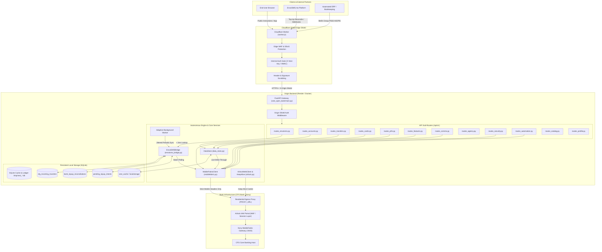

# VextOpenBank — Comprehensive System Map & LLM Navigation Index

> **Target Audience:** Autonomous Agents, LLMs, Security Auditors, and Senior Systems Engineers  
> **Repository:** `abdnaouri/VextOpenBank`  
> **Status:** Production-Grade / Active Deployment  
> **Architecture Style:** Decoupled Edge-Shielded Reverse Proxy & Autonomous Banking Bridge

---

## 1. High-Level System Architecture



---

## 2. Source Code Directory Structure

```
VextOpenBank/
├── .env.example                     # Environment template with sensitive credential variables
├── Dockerfile                       # Multi-stage production container build
├── pipeline.sh                      # 6-stage APK analysis & contract discovery pipeline
├── README.md                        # Master repository documentation
├── render.yaml                      # Render.com Infrastructure-as-Code Blueprint
├── requirements.txt                 # Pinned Python production dependencies
├── cloudflare/                      # Edge protection and reverse-proxy layer
│   ├── DEPLOYMENT_GUIDE.md          # Architecture, cost, and rollout manual
│   ├── Dockerfile                   # Hardened unprivileged container definition
│   ├── cloudflared.yml              # Cloudflare Tunnel (Zero Trust) ingress config
│   ├── docker-compose.yml           # Local production stack composition
│   ├── security_rules.json          # WAF threat scoring and rate-limiting rules
│   ├── worker.js                    # Cloudflare Worker Edge Shield & header scrubber
│   └── wrangler.toml                # Cloudflare Worker deployment manifest
├── docs/                            # Deep-dive enterprise architectural documentation
│   ├── API_REFERENCE.md             # Complete OpenAPI route specification & schemas
│   ├── ARCHITECTURE.md              # Core design patterns, lifecycle, and data flow
│   ├── ENVOISMS_INTEGRATION.md      # EnvoiSMS bank reconciliation bridge integration
│   ├── SECURITY.md                  # Zero-Trust security model, header hygiene & WAF mitigation
│   └── SYSTEM_MAP.md                # (This file) Machine & human navigation roadmap
├── scripts/                         # Automation & reverse engineering tooling
│   ├── compare_endpoints.py         # Static vs dynamic endpoint reconciliation
│   ├── discover_contract.py         # AST parser extracting service names from decompiled APK
│   ├── gen_harness.py               # Generates Python replay harness from contracts
│   ├── install_toolchain.sh         # macOS Homebrew & Python toolchain bootstrap
│   ├── orchestrate.sh               # Runs full end-to-end analysis orchestration
│   ├── profile.sh                   # APK manifest and security packer fingerprinting
│   ├── reconcile_surfaces.py        # Compares static interface contracts with dynamic Frida captures
│   └── setup.sh                     # Runtime environment initialization
├── vext_open_bank/                  # Core Python application package
│   ├── __init__.py                  # Package version and export definitions
│   ├── main.py                      # FastAPI application entrypoint, lifespan & origin middleware
│   ├── run_api.py                   # Dynamic port binding runner for cloud hosts
│   ├── api/                         # REST API route controllers (FastAPI Sub-Routers)
│   │   ├── routes_accounts.py       # Balances, RIB structure, Modulo-97 validation
│   │   ├── routes_agency.py         # Branches, ATMs, appointments, live BAM FX rates
│   │   ├── routes_auth.py           # Legacy authentication endpoints & token management
│   │   ├── routes_automation.py     # Berlin Group PSD2 AIS/PIS & CSV bookkeeping automations
│   │   ├── routes_cards.py          # Debit/credit cards limits, 3DS, lock/unlock
│   │   ├── routes_catalog.py        # 42 discovered MobileFabric integration services
│   │   ├── routes_comms.py          # Bank secure messaging inbox, Dynamics CRM, KPNS push
│   │   ├── routes_envoisms.py       # EnvoiSMS.ma automated bank bridge & reconciliation
│   │   ├── routes_features.py       # Dotations, billers, interbank wallet, check OCR
│   │   ├── routes_pfm.py            # Personal Finance Management spending taxonomy & trends
│   │   ├── routes_profile.py        # Customer profile, relationship manager, branch directory
│   │   ├── routes_security.py       # Step-up MFA challenge-verify state machine
│   │   └── routes_transfers.py      # Domestic bank transfers, payees, and impayés
│   ├── core/                        # Configuration & persistence foundation
│   │   ├── config.py                # Pydantic Settings, .env auto-loader & stable device profiling
│   │   └── exchange_logger.py       # Thread-safe connection exchange & telemetry discovery engine
│   ├── frontend/                    # Built-in diagnostic & operations dashboard
│   │   └── dashboard.html           # Single-page operations portal with tabbed views
│   ├── services/                    # Business logic and external protocol clients
│   │   ├── airlock.py               # Async Airlock IAM session keep-alive client
│   │   ├── data_store.py            # Write-through caching service (SQLite fallback)
│   │   ├── envoisms_bridge.py       # Autonomous reconciliation engine & background worker
│   │   ├── mobilefabric.py          # Kony MobileFabric protocol client with jitter & JWT reuse
│   │   └── onegini.py               # Onegini token registration and client stubs
│   └── tests/                       # Automated Pytest validation test suite
│       ├── test_envoisms.py         # End-to-end EnvoiSMS bridge, HMAC & anti-throttling tests
│       ├── test_features.py         # Cheque deposits, bill payments, and dotations tests
│       └── test_full_suite.py       # Comprehensive 15-point integration test suite
└── work/                            # Analysis artifacts, Frida scripts & contract reports
    ├── contract/                    # Discovered interface contracts and schemas
    ├── dynamic/                     # Frida hooks (SSL unpinning, transport logging)
    ├── inbox/                       # Input APK drop directory
    ├── logs/                        # Pipeline execution logs and captured traces
    └── repro/                       # Standalone replay scripts and Kotlin stubs
```

---

## 3. Module Breakdown & Responsibility Matrix

### Core Application (`vext_open_bank/`)

| File Path | Primary Responsibilities | Key Classes / Functions | Dependencies |
| :--- | :--- | :--- | :--- |
| [`main.py`](file:///Users/naouri/Downloads/VextOpenBank/vext_open_bank/main.py) | Application root, lifespan daemon manager, CORS, Origin-Shield security middleware, router registry. | `app`, `lifespan()`, `enforce_internal_security()`, `serve_dashboard()` | FastAPI, Starlette |
| [`run_api.py`](file:///Users/naouri/Downloads/VextOpenBank/vext_open_bank/run_api.py) | CLI bootstrap resolving `PORT` and `HOST` dynamically for Render/Docker. | `main()` | Uvicorn |
| [`core/config.py`](file:///Users/naouri/Downloads/VextOpenBank/vext_open_bank/core/config.py) | Environment configuration, zero-dependency `.env` parsing, persistent hardware device profile generation. | `Settings`, `_load_env_file()`, `_get_persistent_device_profile()` | Pydantic, JSON, UUID |
| [`core/exchange_logger.py`](file:///Users/naouri/Downloads/VextOpenBank/vext_open_bank/core/exchange_logger.py) | Thread-safe connection exchange logger, schema discovery engine, query/payload sanitization, and JSONL log rotation. | `ExchangeLogger`, `exchange_logger`, `log_exchange()`, `inspect_exchange()` | Pathlib, Regex, Threading, JSON |
| [`services/mobilefabric.py`](file:///Users/naouri/Downloads/VextOpenBank/vext_open_bank/services/mobilefabric.py) | Low-level Kony MobileFabric gateway client. Enforces mobile header whitelisting, JWT `exp` parsing, token reuse, human micro-jitter, and 401/429 backoff handling. | `MobileFabricClient`, `invoke_service()`, `login_claims()`, `trigger_mfa_challenge()` | Requests, Base64, JSON |
| [`services/envoisms_bridge.py`](file:///Users/naouri/Downloads/VextOpenBank/vext_open_bank/services/envoisms_bridge.py) | High-speed bank reconciliation engine. Manages `cfg_incoming_transfers`, `bank_topup_reconciliations`, and `pending_topup_intents`. Operates background sync daemon with natural human jitter. | `EnvoiSMSBridge`, `reconcile_topup()`, `sync_from_cfg()`, `run_sync_worker()` | SQLite3, HMAC, Hashlib, Asyncio |
| [`services/airlock.py`](file:///Users/naouri/Downloads/VextOpenBank/vext_open_bank/services/airlock.py) | Async Airlock IAM web portal keep-alive worker. Periodically refreshes `AL_SESS-S` cookie and CSRF tokens to preserve backend sessions. | `AirlockWebClient`, `airlock_keepalive_worker()`, `_keepalive_once()` | HTTPX, BeautifulSoup4 |
| [`services/data_store.py`](file:///Users/naouri/Downloads/VextOpenBank/vext_open_bank/services/data_store.py) | Two-tier write-through caching layer. Queries live MobileFabric integration services first, falling back to SQLite tables during outages. | `DataStore`, `get_account_details()`, `get_user_profile()`, `_write_cache()` | SQLite3, JSON |

---

### API Route Endpoints (`vext_open_bank/api/`)

| Sub-Router | URL Prefix | Purpose & MobileFabric Backing Services | Key Endpoints |
| :--- | :--- | :--- | :--- |
| `routes_envoisms.py` | `/api/v1/envoisms` | Top-Up reconciliation bridge with EnvoiSMS.ma. Sub-5ms local resolution, cryptographic HMAC SHA-256 signatures, and anti-throttling shields. | `GET /instructions`<br>`POST /check-topup`<br>`GET /sync-status`<br>`POST /simulate-incoming-transfer` |
| `routes_accounts.py` | `/api/v1/accounts` | Account balance summaries, Moroccan 24-digit RIB formatting, Modulo-97 checksum validation. Backed by `CFGAccountOverview`. | `GET /`<br>`GET /rib`<br>`POST /validate-rib`<br>`GET /overview-live` |
| `routes_transfers.py` | `/api/v1/transfers` | Domestic bank transfers, registered payees management, and unpaid direct debits/cheques (`impayés`). Backed by `CFGManagePayees`, `CFGTransfersPaymentsOverview`, `CFGImpayees`. | `GET /payees`<br>`POST /payees`<br>`POST /execute`<br>`GET /impayes` |
| `routes_cards.py` | `/api/v1/cards` | Debit/credit card lifecycles, online payment flags, ATM limits, remote lock/unlock. Backed by `CFGCardLimits`, `CFGCardManagement`. | `GET /`<br>`POST /{card_id}/toggle-lock`<br>`POST /{card_id}/limits` |
| `routes_pfm.py` | `/api/v1/pfm` | Personal Finance Management spending classification (Donut) and liquidity forecasting. Backed by `CFGDataServices/cfgPFMDonut`. | `GET /categories`<br>`GET /donut`<br>`GET /transactions` |
| `routes_features.py` | `/api/v1/features` | Forex dotations (Office des Changes), billers catalog & settlement, interbank mobile wallet (EMVCo QR), remote cheque deposit (OCR). | `GET /dotations`<br>`POST /billers/pay`<br>`POST /wallet/transfer`<br>`POST /cheques/deposit` |
| `routes_comms.py` | `/api/v1/comms` | Bank messaging inbox, Microsoft Dynamics CRM customer support incident creation, Kony KPNS push notification subscriptions. | `GET /inbox`<br>`POST /incident/create`<br>`POST /push/subscribe` |
| `routes_agency.py` | `/api/v1/agency` | Physical branch and ATM locator, branch appointment booking, live Bank Al-Maghrib FX exchange rates. | `GET /locations`<br>`POST /appointments`<br>`GET /rates` |
| `routes_security.py` | `/api/v1/security` | Step-Up MFA challenge trigger (SMS / Entrust) and OTP verification to mint elevated claims tokens. Backed by `MFAOtp`, `AcccessTokenForMFA`. | `POST /mfa/challenge`<br>`POST /mfa/verify`<br>`GET /token/validate` |
| `routes_automation.py`| `/api/v1/automation`| Berlin Group NextGenPSD2 AIS/PIS schema compliance, CSV transaction bookkeeping export, automated balance alerts. | `GET /open-banking/accounts`<br>`GET /export/csv`<br>`POST /monitor/balance` |
| `routes_catalog.py` | `/api/v1/catalog` | Introspection of 42 discovered MobileFabric backend services and registered biller taxonomy. | `GET /services`<br>`GET /billers` |
| `routes_profile.py` | `/api/v1/profile` | Customer profile, relationship manager contact, managing branch details. | `GET /`<br>`GET /advisor` |

---

## 4. Edge Layer (`cloudflare/`)

* **Edge Shield Worker (`worker.js`)**:
  * Intercepts all traffic at Cloudflare's edge.
  * Enforces `X-Vext-Key` or EnvoiSMS HMAC authentication.
  * Allows public read access to `/api/v1/envoisms/instructions`.
  * Injects `X-Origin-Shield` token so the Render backend only accepts legitimate Cloudflare traffic.
  * Scrubs internal origin headers (`Server`, `x-powered-by`, `rndr-id`, `x-render-origin-server`).
  * Enforces strict HSTS, `X-Frame-Options: DENY`, and `X-Content-Type-Options: nosniff`.
* **Deployment Manifest (`wrangler.toml`)**:
  * Configuration targeting worker `vext-open-bank-edge`.
  * Injects environment variables: `BACKEND_ORIGIN`, `MAX_REQUESTS_PER_MINUTE`, `INTERNAL_API_KEY`, `ORIGIN_SHIELD_SECRET`.

---

## 5. Security & Isolation Invariants

1. **CFG Origin Isolation**:
   * CFG Bank **never** sees client IPs from EnvoiSMS, Cloudflare, or end-user browsers.
   * Outbound calls from `MobileFabricClient` strip `X-Forwarded-For`, `CF-Connecting-IP`, `Origin`, and `Referer`.
   * Outbound traffic routes through `PROXY_URL` (residential/static Moroccan proxy) if configured.
2. **Behavioral AI Evasion**:
   * Outbound sync cadence uses randomized Gaussian jitter ($\pm 15\%$) to emulate human mobile behavior.
   * Valid JWT claims tokens are reused based on parsed `exp` timestamps, eliminating login churn alerts.
   * Automatic backoff handles HTTP `429 Too Many Requests` using server-provided `Retry-After` headers.
3. **Decoupled Local Ledger**:
   * Top-up checks (`/check-topup`) resolve from SQLite in **$< 5\text{ ms}$**.
   * Outbound CFG syncs are throttled to a minimum **25-second cooldown**, making the bank connection immune to traffic surges.
